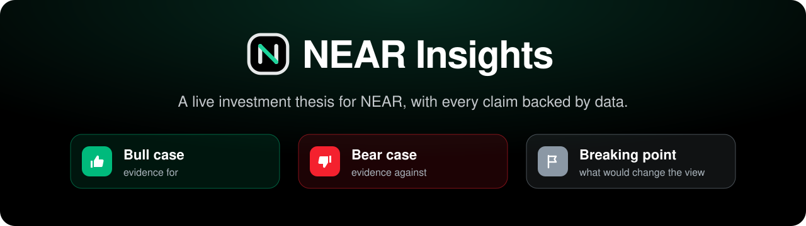
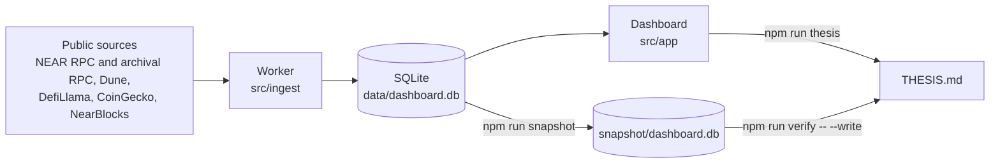
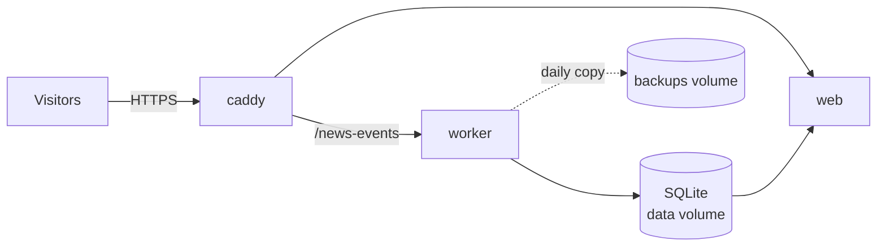

<div align="center">

# NEAR Insights

**A dynamic, re-runnable long-term investment thesis for NEAR, built from public on-chain and market data: on the dashboard, the verdict and every thesis's status update automatically as new data arrives. NEAR HACKATHON 2026, Investment Thesis track (`thesis`).**



**Live dashboard: [nearinsight.xyz](https://nearinsight.xyz)** · **Thesis document: [THESIS.md](THESIS.md)**

</div>


<h2 align="center">⭐ Overview ⭐</h2>

**The problem.** NEAR's investment case rests on one test: does the NEAR that usage burns and buys keep pace with the NEAR the protocol mints? Since 2026-02-23 the fees of NEAR Intents apps buy NEAR on the open market, gas fees burn NEAR, and the protocol mints new NEAR every epoch. Nobody publishes these three side by side.

**What this is.** A worker reads free public sources (NEAR RPC, a NEAR archival RPC for block headers, the NEAR team's Dune dashboard, DefiLlama, CoinGecko, NearBlocks, the House of Stake voting contract, and for context GitHub, Electric Capital, CryptoPanic and ChainCatcher) into a local SQLite database. A Next.js dashboard and a generated [THESIS.md](THESIS.md) read only that database, so every number can be rebuilt from the sources.

**The thesis.** NEAR Intents turns cross-chain trading into buying of NEAR; if the NEAR it buys plus the NEAR burned grows to match the NEAR issued, all new supply is burned or held off the market. **[THESIS.md](THESIS.md)** sets out its three pillars, the valuation and three supporting theses (technology, network, peers). It is a dated copy of the verdict and every number, generated from the committed database snapshot; the live dashboard shows the same sections with the latest data.


<h2 align="center">🏃 Quick Start for judges 🏃</h2>

| 🌐 Live · no setup | 📴 Offline check · 2 min | 🔄 Fresh data · about 10 min |
| --- | --- | --- |
| Open **[nearinsight.xyz](https://nearinsight.xyz)** | `npm ci`<br>`npm run check` | `npm ci`<br>`pip install -r requirements.txt`<br>`npm run rebuild` |
| The live dashboard with its worker: numbers move as new data arrives | Type check, lint and the tests, then renders THESIS.md from the committed snapshot and checks it matches the committed file | Reads every public source, writes a new snapshot and regenerates THESIS.md; block headers older than the committed snapshot are copied from it, as they never change |
| Nothing to install | Node.js >= 22.18 | Node.js >= 22.18 and Python >= 3.10 |
| You see the **Verdict** on Home | Ends with `THESIS.md matches …` and exit code 0 | Ends with a new THESIS.md and snapshot |

<sub>To look around the snapshot's data offline, run `npm run dev:snapshot` and open http://localhost:3000/dashboard/home.</sub>

<sub>To read every block header from the chain instead of the snapshot, delete `snapshot/` (and `data/dashboard.db`, if an earlier run created it) first. The ingest step then takes about 55 min on the free RPC, or about 6 min with your own archival RPC and its rate limit set in `.env`:</sub>

```bash
NEAR_ARCHIVAL_RPC_URL=<your archival RPC URL>
NEAR_ARCHIVAL_RPC_RATE_PER_MINUTE=720
```


<h2 align="center">✨ Features ✨</h2>

| Feature | What it does |
| --- | --- |
| **Dynamic verdict** | Home and THESIS.md open with what the latest data supports and what it does not; on the dashboard it is rewritten whenever the worker stores new data. |
| **Bull case, bear case and breaking point** | Every thesis states its claim, then sentences written from the numbers, each placed on the side its value supports, then a breaking point with an exact threshold and a live status: Holding, Broken, Too close to call or Not measured yet. |
| **The SQL behind every chart** | Each chart's **Query** tab shows a plain sentence and its SQL, and **Run query** returns the rows; the same statements run on `/dashboard/queries`, at `GET /api/query/{id}` and with `npm run query`. |
| **Data checks** | Six checks on `/dashboard/methodology`, each setting two independent figures side by side with their difference; for example NEAR bought as counted from fees against the three fee wallets' balance change on chain. |
| **Reproducible results** | `snapshot/dashboard.db` is committed with its SHA-256: `npm run verify` renders THESIS.md from it with no network and confirms it matches the committed file (`npm run verify -- --write` rewrites it), and `npm run rebuild` rebuilds everything from the public sources. |


<h2 align="center">🗺️ How it works 🗺️</h2>



| Path | What it holds |
| --- | --- |
| `src/ingest/` | The worker: one job per dataset on its own schedule (`jobs/`), reading each source through `sources/` with validation, retries and rate-limit pacing |
| `src/config/` | Every setting: sources and their limits, job schedules, breaking-point thresholds and protocol constants |
| `src/db/` | The schema, the SQL behind every chart (`named-queries/`) and the worker's daily backup |
| `src/data/`, `src/lib/` | Readers of the database and the pure calculations (metrics, projections, bootstrap, lead-lag); `src/lib/thesis/` writes the bull and bear cases, breaking points and verdict from the numbers |
| `src/content/thesis.ts` | The fixed claims; every statement the data could change is written from the numbers instead |
| `src/app/`, `src/components/`, `src/server/`, `src/proxy.ts` | The dashboard pages, `src/app/api/thesis/` which renders THESIS.md, the web container's health check, and the proxy that answers 404 to a link to a story that is not stored |
| `snapshot/`, `scripts/`, `tests/` | The committed database snapshot, the npm script tools, and the tests |


<h2 align="center">🚀 Deploy on a server 🚀</h2>

You need a server with Docker, ports 80 and 443 open, and DNS A records for the domain and its `www` pointing at the server. Everything else runs in containers.

```bash
git clone <repository URL> near-insights && cd near-insights
cp .env.example .env    # set SITE_DOMAIN=<domain>, and any API keys
docker compose up -d --build
```

The image does not include the snapshot, so on a new server the worker first reads every epoch block header from the archival RPC, newest first. Until the epochs they need are stored, the panels built on minted and burned NEAR say "This data is not complete yet" and their breaking points show "Not measured yet": the 30-day figures arrive after the first run, the full history after about an hour and a half on the free RPC, as the worker reads for 8 minutes and then waits 5. Your own archival RPC in `.env` (see the Quick Start) shortens it.



- **Restarts.** Every container restarts when it exits, and all of them start with the server. Docker does not restart a container that hangs, so the worker and the website exit instead: the worker when no job has finished for 15 minutes, and the website when its health check gets no answer three times in a row.
- **Security.** Every container runs read-only apart from its data, with no Linux capabilities (Caddy keeps only the one to bind ports 80 and 443), no privilege gain, and limits on CPU, memory and processes. The app runs as a non-root user, and only Caddy's ports are published. The images are pinned by digest.
- **Backups.** The worker copies the database once a day to its own `backups` volume, which the website cannot reach, and keeps 14 days. To go back to one (list them with `docker compose exec worker ls /app/backups`):

  ```bash
  docker compose stop web worker
  docker compose run --rm --no-deps worker sh -c 'cp /app/backups/dashboard-<day>.db /app/data/dashboard.db && rm -f /app/data/dashboard.db-wal /app/data/dashboard.db-shm'
  docker compose start worker web
  ```

- **Updates.** Run `git pull && docker compose up -d --build`, then `docker image prune -f && docker builder prune -f --filter until=168h` to delete the replaced image and build cache older than a week, so the disk does not fill over many updates.


<h2 align="center">📜 Disclaimer & License 📜</h2>

For research and education only. This is not investment, financial or legal advice.

- **Built with AI assistance.** The code and documentation were written with AI assistance (Claude Code), directed and reviewed by the author.
- **Libraries** (versions locked in `package-lock.json`): Next.js, React, Tailwind CSS, TypeScript, ESLint, hyparquet and hyparquet-compressors, ws; Python with curl_cffi for the Dune reader. The database is Node's built-in SQLite, and the tests use Node's built-in test runner.
- **Data.** Developer data: Open Dev Data by Electric Capital (Electric Capital Partners, LLC), CC BY 4.0. Every source is listed on `/dashboard/methodology#sources`.

Released under the **MIT License**; see [LICENSE](LICENSE).


