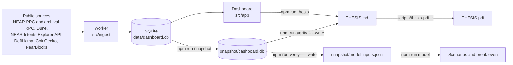
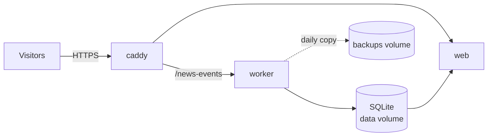

<div align="center">

# NEAR Insights

**A re-runnable long-term investment thesis for NEAR, built from public onchain and market data. On the live dashboard, the verdict and each thesis's status update as new data arrives. Entry for NEAR HACKATHON 2026, Investment Thesis track (`thesis`).**


**Live dashboard: [nearinsight.xyz](https://nearinsight.xyz)** · **Thesis document: [THESIS.md](THESIS.md)** · **PDF: [THESIS.pdf](THESIS.pdf)**

</div>


<h2 align="center">⭐ Overview ⭐</h2>

**The problem.** NEAR's investment case rests on one test: whether the NEAR that usage burns and buys keeps pace with the NEAR the protocol mints. Since 2026-02-23, NEAR Intents app fees buy NEAR on the open market, gas fees burn NEAR, and the protocol mints new NEAR every epoch. This project measures the three side by side.

**What this is.** A live dashboard and a generated thesis document that measure those three flows. A worker reads free public sources into a local SQLite database: NEAR RPC, a NEAR archival RPC for block headers, the NEAR team's Dune dashboard, the NEAR Intents Explorer API (free partner key), DefiLlama, CoinGecko, NearBlocks and the House of Stake voting contract, plus GitHub, Electric Capital, CryptoPanic and ChainCatcher for context. The Next.js dashboard and [THESIS.md](THESIS.md) read only that database, so every number can be rebuilt from the sources.

**The thesis.** NEAR Intents turns cross-chain trading into NEAR bought. If NEAR bought plus NEAR burned grows to match NEAR minted, all new supply is burned or held off the market. **[THESIS.md](THESIS.md)** sets out three pillars, the valuation and three supporting theses (technology, network, peers). It is a dated copy of the verdict and every number, generated from the committed database snapshot. The live dashboard shows the same sections with the latest data.


<h2 align="center">🎯 Track requirements 🎯</h2>

Each row is an item that the Investment Thesis track (`thesis`) or its example prompt asks for, and where this repository meets it.

| Requirement | Where it is met |
| --- | --- |
| A long-term investment thesis for NEAR | [THESIS.md](THESIS.md), the same document typeset as a paper in [THESIS.pdf](THESIS.pdf) (a dark cover with the key figures, then each section on its own page), and the live dashboard: the verdict, three pillars, the valuation and three supporting theses, each with its claim, bull case, bear case and breaking point |
| Onchain analytics (hint: onchain data) | Read over NEAR RPC (`src/ingest/sources/near.ts`): NEAR minted and burned per epoch from archival block headers, validator stake, the House of Stake vote, and the fee wallet and protocol treasury balances. NearBlocks adds each wallet's past daily balances |
| Live dashboards (hint: dashboards) | [nearinsight.xyz](https://nearinsight.xyz): the worker reads each source on its own schedule, and the verdict and every breaking point are recomputed from each new reading |
| Models anyone can re-run | `npm run model` (offline, from the committed snapshot), the model on `/dashboard/valuation`, and `GET /api/model` (every scenario month by month as CSV) |
| One command that rebuilds every chart from raw data | `npm run rebuild` |
| Each chart with the query behind it and one plain sentence | The **Query** tab of every chart, `/dashboard/queries`, `GET /api/query/{id}` and `npm run query -- <id>` |
| THESIS.md with the claim, the evidence for and against, and what would change the view | THESIS.md: each section's claim, bull case, bear case and breaking point, then section 11, "What would change our mind" (every breaking point and its status) |
| No invented numbers; what cannot be computed is stated | THESIS.md, section 12, "What we could not measure"; a missing window shows "—" and is never estimated |
| Swap data from the NEAR Intents Explorer API | Completed 1Click swaps by referral, stored as daily totals (`src/ingest/jobs/intents-explorer.ts`) and shown in "Who pays NEAR Intents fees" on `/dashboard/revenue`. The committed snapshot holds the first 5 of the 30 days its figures need; the live dashboard fills them as days are stored |
| SQL on the NEAR BigQuery public dataset | Not used. The dataset is loaded from NEAR Lake, which NEAR's docs say was deprecated on 2026-03-24 and no longer indexes new blocks; the docs say the dataset stays available, but its loader names no other source (THESIS.md, section 12). Every chart's SQL runs on the dashboard's own SQLite database instead |
| The working hypothesis: Intents volume leads usage better than price | THESIS.md, section 10, "Lead-lag test": weekly Intents volume growth against NEAR's return beyond BTC and ETH and against active-accounts growth, and NEAR's return against active-accounts growth, Holm-corrected |
| Judged on the evidence (hint: research) | Seven data checks on `/dashboard/methodology`, each comparing two independent figures; bootstrap 95% ranges and Holm-corrected lead-lag tests |


<h2 align="center">🏃 Reproduce and verify 🏃</h2>

The live dashboard needs nothing installed. The commands need Node.js >= 22.18 and `npm ci`. `npm run rebuild` also needs Python >= 3.11 and `pip install -r requirements.txt`. Writing THESIS.pdf (`npm run rebuild`, `npm run thesis`, `npm run verify -- --write`) needs Chrome, Edge or Chromium, in its usual install location or at `CHROME_PATH`.

| Command | What it does | Expected output |
| --- | --- | --- |
| Open **[nearinsight.xyz](https://nearinsight.xyz)** | The live dashboard with its worker | The **Verdict** on Home, then each thesis with its breaking point and status |
| `npm run check` | Type check, lint and the unit tests, then `npm run verify` | All tests pass, then the output of `npm run verify`; exit code 0 |
| `npm run verify` | Checks `snapshot/dashboard.db` against its SHA-256, starts the dashboard on a copy without calling any data source, and renders THESIS.md and the model inputs from it (about 2 min) | `THESIS.md matches …`, `snapshot/model-inputs.json matches the snapshot.`, then the verdict, every breaking point with its status and every data check; exit code 0 |
| `npm run model` | Runs the projection from `snapshot/model-inputs.json`, offline | Each scenario with the month NEAR burned plus NEAR bought reaches issuance and the share absorbed in month 36, then the growth needed, the measured growth and the break-even volume |
| `npm run model -- --price 5 --bought 0.05 --fees 0 --cap 0.016 --burn 1` | The Valuation page's model with these inputs, in flag order: NEAR price in USD, monthly growth of NEAR bought, monthly growth of gas fees, the max issuance at the end of HSP-029's ramp, and the share of gas fees burned | One line of inputs, then the share absorbed in month 1 and month 36, the month it reaches 100% and total supply growth a year |
| `npm run query -- fee-chain-30d --db snapshot/dashboard.db` | Runs one chart's SQL on the snapshot; `npm run query` lists every query | The query's sentence, its sources, its SQL and its rows |
| `npm run dev:snapshot` | Serves the dashboard on a copy of the snapshot | The dashboard at http://localhost:3000/dashboard/home |
| `npm run rebuild` | Reads every public source, writes a new snapshot, then THESIS.md, THESIS.pdf and the model inputs from it (about 10 min; longer on the first run with an Explorer API key) | A new `snapshot/`, THESIS.md, THESIS.pdf and `snapshot/model-inputs.json`, then the verdict, every breaking point with its status and every data check |

<sub>`npm run rebuild` reads the NEAR Intents Explorer API only when `.env` sets `NEAR_INTENTS_EXPLORER_API_KEY` to a free partner key (partners.near-intents.org). Its first run reads 35 days, about 80 min at the API's limit of one request every 5 seconds. Block headers older than the committed snapshot are copied from it, since they never change. To read every block header from the chain instead, first delete `snapshot/` (and `data/dashboard.db`, if an earlier run created it). The ingest step then takes about 55 min on the free RPC, or about 6 min with your own archival RPC and its rate limit set in `.env`:</sub>

```bash
NEAR_ARCHIVAL_RPC_URL=<your archival RPC URL>
NEAR_ARCHIVAL_RPC_RATE_PER_MINUTE=720
```


<h2 align="center">✨ Features ✨</h2>

| Feature | What it does |
| --- | --- |
| **Live verdict** | Home and THESIS.md open with what the latest data supports and what it does not. On the dashboard, the verdict is rewritten whenever the worker stores new data. |
| **Bull case, bear case and breaking point** | Every thesis states its claim, then sentences written from the numbers, each on the side its value supports. A breaking point follows, with an exact threshold and a live status: Holding, Broken, Too close to call or Not measured yet. |
| **The SQL behind every chart** | Each chart's **Query** tab shows a plain sentence and its SQL, and **Run query** returns the rows. The same statements run on `/dashboard/queries`, at `GET /api/query/{id}` and with `npm run query`. |
| **Who pays the fees** | Completed 1Click swaps over 30 days by referral (the front end, wallet or app a swap came through), with each referral's app fees, shares of fees and volume, and fee rate. The largest referral's share of fees is a finding of *That trading buys NEAR*, on its bear side once one referral pays half the fees or more. |
| **Data checks** | Seven checks on `/dashboard/methodology`, each showing two independent figures side by side with their difference. One compares NEAR bought as counted from fees with the three fee wallets' balance change on chain. |
| **Re-runnable model** | Projects NEAR burned and NEAR bought against issuance, month by month for 36 months. Scenarios include buying stopping, NEAR bought halving and HSP-029's lower max issuance. The model runs on `/dashboard/valuation`, at `GET /api/model` and offline with `npm run model`. |
| **Reproducible results** | `snapshot/dashboard.db` is committed with its SHA-256. `npm run verify` renders THESIS.md and the model inputs from it without calling any data source and confirms both match the committed files. `npm run verify -- --write` rewrites them and prints THESIS.pdf from THESIS.md, and `npm run rebuild` rebuilds everything from the public sources. |


<h2 align="center">🗺️ How it works 🗺️</h2>



| Path | What it holds |
| --- | --- |
| `src/ingest/` | The worker: one job per dataset on its own schedule (`jobs/`), reading each source through `sources/` with validation, retries and rate-limit pacing |
| `src/config/` | Every setting: sources and their limits, job schedules, breaking-point thresholds and protocol constants |
| `src/db/` | The schema, the SQL behind every chart (`named-queries/`) and the worker's daily backup |
| `src/data/`, `src/lib/` | Readers of the database and the pure calculations (metrics, projections, bootstrap, lead-lag); `src/lib/thesis/` writes the bull and bear cases, breaking points and verdict from the numbers |
| `src/content/thesis.ts` | The fixed claims. Any statement the data could change is written from the numbers instead |
| `src/app/`, `src/components/`, `src/server/`, `src/proxy.ts` | The dashboard pages, the THESIS.md renderer (`src/app/api/thesis/`), the web container's health check, and the proxy that answers 404 for a link to a story that is not stored |
| `snapshot/`, `scripts/`, `tests/` | The committed database snapshot, the scripts behind the npm commands, and the tests |


<h2 align="center">🚀 Deploy on a server 🚀</h2>

You need a server with Docker and at least 2 CPUs (or `WEB_CPUS=1` in `.env`), ports 80 and 443 open, and DNS A records for the domain and its `www` pointing at the server. Everything else runs in containers.

```bash
git clone <repository URL> near-insights && cd near-insights
cp .env.example .env    # set SITE_DOMAIN=<domain>, and any API keys
docker compose up -d --build
```

The image does not include the snapshot, so on a new server the worker first reads every epoch block header from the archival RPC, newest first. Until the epochs they need are stored, panels built on NEAR minted and NEAR burned say "This panel is waiting for data", and their breaking points show "Not measured yet". The 30-day figures arrive after the first run. The full history takes about an hour and a half on the free RPC, since the worker reads for 8 minutes and then waits 5. Your own archival RPC, set in `.env` as under Reproduce and verify, shortens this.



- **Restarts.** Every container restarts when it exits, and all of them start with the server. Docker does not restart a container that hangs, so the worker and the website exit instead: the worker when no job has finished for 15 minutes, and the website when its health check gets no answer three times in a row.
- **Security.** Every container runs read-only apart from its data, with no Linux capabilities (Caddy keeps only the one to bind ports 80 and 443), no privilege gain, and limits on CPU, memory and processes. The app runs as a non-root user, and only Caddy's ports are published. The images are pinned by digest.
- **Backups.** The worker copies the database once a day to its own `backups` volume, which the website cannot reach, and keeps 14 days. To restore one (list them with `docker compose exec worker ls /app/backups`):

  ```bash
  docker compose stop web worker
  docker compose run --rm --no-deps worker sh -c 'cp /app/backups/dashboard-<day>.db /app/data/dashboard.db && rm -f /app/data/dashboard.db-wal /app/data/dashboard.db-shm'
  docker compose start worker web
  ```

- **Updates.** `git pull && docker compose up -d --build` updates the site. `docker image prune -f && docker builder prune -f --filter until=168h` then deletes the replaced image and build cache older than a week, so the disk does not fill over many updates.


<h2 align="center">📜 Disclaimer & License 📜</h2>

For research and education only. This is not investment, financial or legal advice.

- **Built with AI assistance.** The code and documentation were written with Claude Code, directed and reviewed by the author.
- **Libraries** (versions locked in `package-lock.json`): Next.js, React, Tailwind CSS, TypeScript, ESLint, hyparquet and hyparquet-compressors, ws; the Inter font (Google Fonts, through next/font) on the dashboard; marked and the Plus Jakarta Sans and JetBrains Mono fonts (Fontsource, SIL Open Font License 1.1) for THESIS.pdf; Plus Jakarta Sans also in the README banners; Python with curl_cffi for the Dune reader. The database is Node's built-in SQLite, and the tests use Node's built-in test runner.
- **Data.** Developer data: Open Dev Data by Electric Capital (Electric Capital Partners, LLC), CC BY 4.0. Every source is listed on `/dashboard/methodology#sources`.

Released under the **MIT License**; see [LICENSE](LICENSE).


